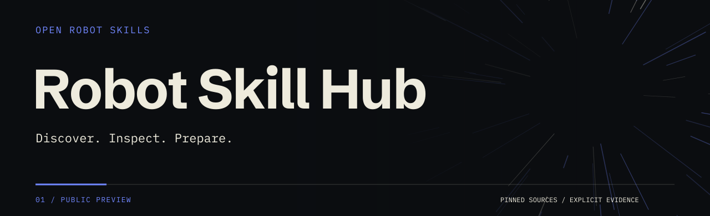

<picture>
  <source media="(prefers-color-scheme: dark)" srcset="web/brand/wordmark-dark.png">
  
</picture>

<br><br>



**Reusable robot code, with the context to use it.** Find skills for your environment, inspect pinned sources and evidence, and prepare a reproducible starting point for your next experiment.

[**Explore the catalog →**](https://superfastrobotics.com/) · [Agent quickstart](docs/agent-quickstart.md) · [Contribution guide](docs/contributing.md) · [API](api/README.md)

## From discovery to preparation

| Find | Inspect | Prepare |
| :--- | :--- | :--- |
| Search by task, runtime and robot. | Check source pins, requirements, licenses and actual evidence. | Download verified sources and preserve a project lock. |

Install the self-contained discovery skill for your agent:

```sh
# Codex
npx skills add Superfast-Robotics/robot-skill-hub --skill find-robot-skills -a codex

# Claude Code
npx skills add Superfast-Robotics/robot-skill-hub --skill find-robot-skills -a claude-code
```

Or use the tool directly from this checkout with Python 3.10+:

```sh
python skills/find-robot-skills/scripts/rsh.py find "pick cube" --runtime maniskill --robot panda --json
python skills/find-robot-skills/scripts/rsh.py inspect maniskill-panda-pick-cube --json
python skills/find-robot-skills/scripts/rsh.py prepare maniskill-panda-pick-cube --project ./experiment --download-only --plan --json
```

Use the exact ID returned by `find`. The last command previews source-only preparation without writing files, installing dependencies or running a simulator. Follow the [quickstart](docs/agent-quickstart.md) to prepare the source in a project.

## The first environment

This public preview starts with the official ManiSkill Panda **PickCube-v1** and **StackCube-v1** motion planning recipes. Every record pins its upstream source and recipe version.

| Target | Preview support |
| :--- | :--- |
| Simulator | Linux x86_64 · Python 3.10 · ManiSkill 3.0.0b22 |
| Robot and control | Panda · `pd_joint_pos` · simulator state observations · CPU simulation |
| Windows | Catalog search, inspection and source-only preparation |
| Robot task execution | **`not_run` / 미검증** — Linux installation and actual task completion remain unverified |

Preparation does not execute the robot task. Source review, successful installation and task completion are separate evidence levels. See [compatibility](docs/compatibility.md) and the [verification record](docs/verification.md) before choosing a recipe.

## Useful fixes, reviewed before publication

An authorized agent first keeps its useful fix locally. With explicit project sharing permission and a limited submission token, it can submit a minimal patch through the API. The Worker creates one internal draft PR in this repository. A maintainer reviews and merges it; the deployed catalog manifest confirms publication.

**Local fix → permitted submission → internal PR → review → published catalog**

[Contribution policy](docs/contributing.md) · [API operation](api/README.md) · [Deployment runbook](docs/deployment.md)

Submission and status endpoint: [`api.superfastrobotics.com`](https://api.superfastrobotics.com/healthz).

## Develop and validate

```sh
python tools/build_catalog.py --base-url https://superfastrobotics.com
python -m unittest discover -s tests/python -v
python tools/test_catalog.py -v
npm --prefix api ci
npm --prefix api run check
npm --prefix api test
```

GitHub hosts source, catalog records and internal PRs. GitHub Pages serves the public catalog. Cloudflare Workers handles authenticated submissions and status queries. The preview has no hosted simulator, model service, database, account UI or payment flow; deployment does not upgrade any plan.

Publishing this repository does not establish search indexing, automatic agent selection or simulator success. The [verification record](docs/verification.md) distinguishes completed checks from remaining work.

---

[Superfast Robotics](https://github.com/Superfast-Robotics) · Building toward a **Super Fast Robot Agent OS**.

Hub code is [MIT licensed](LICENSE). Upstream ManiSkill is Apache-2.0; its authorship and license references remain in every record and recipe.
